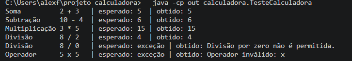
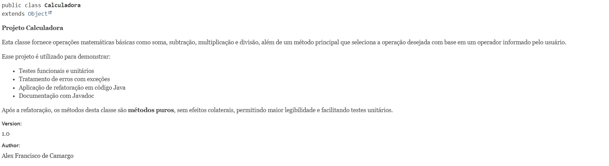
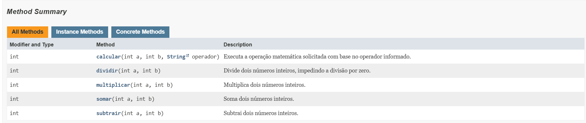

# Projeto Calculadora — FinançApp

> Projeto acadêmico desenvolvido com foco em Qualidade de Software, Testes, Refatoração, Documentação e Versionamento.

---

## 1. Identificação do Projeto

**Projeto:** Projeto Calculadora  
**Contexto:** FinançApp  
**Aluno:** Alex Francisco de Camargo  
**RA:** 251811  
**Turma:** AS406TSN2  
**Curso:** Análise e Desenvolvimento de Sistemas (Facens)  
**Disciplina:** UX/UI e Testes de Software  
**Professor:** Daniel Ohata 
**Semestre:** Segundo Semestre - 2026

---

## 2. Visão Geral

O projeto consiste no desenvolvimento de um módulo de cálculos matemáticos básicos em Java para a startup fictícia **FinançApp**.

O módulo foi desenvolvido com o objetivo de ser utilizado futuramente em funcionalidades de controle financeiro, como:

- orçamento mensal;
- divisão de despesas;
- projeções financeiras;
- cálculos auxiliares.

Além do funcionamento correto das operações, o projeto aplica práticas de qualidade de software relacionadas a:

- testes;
- tratamento de erros;
- refatoração;
- documentação;
- versionamento;
- manutenção de código.

---

## 3. Problema

Durante o desenvolvimento da aplicação FinançApp, foi identificada a necessidade de criar um módulo matemático reutilizável.

Entretanto, a equipe definiu que o módulo não deveria apenas funcionar corretamente, mas também apresentar:

- código legível;
- testes automatizados;
- tratamento de falhas;
- documentação técnica;
- controle de versões;
- facilidade de manutenção.

O desafio consiste, portanto, em desenvolver uma solução funcional e ao mesmo tempo aplicar boas práticas de Engenharia de Software.

---

## 4. Objetivo

### 4.1 Objetivo Geral

Desenvolver uma calculadora em Java aplicando práticas de qualidade, testes, documentação, refatoração e versionamento.

### 4.2 Objetivos Técnicos

- implementar operações matemáticas básicas;
- tratar entradas inválidas;
- impedir divisão por zero;
- desenvolver testes automatizados;
- refatorar o código sem alterar seu comportamento;
- documentar classes e métodos com JavaDoc;
- gerar documentação HTML;
- utilizar Git e GitHub;
- organizar commits e branches;
- manter documentação técnica no README.

---

## 5. Escopo Funcional

A aplicação oferece as seguintes operações:

| ID   | Funcionalidade       | Descrição                        | Status |
| ---- | -------------------- | -------------------------------- | ------ |
| RF01 | Soma                 | Soma dois números inteiros       | ✅      |
| RF02 | Subtração            | Subtrai dois números inteiros    | ✅      |
| RF03 | Multiplicação        | Multiplica dois números inteiros | ✅      |
| RF04 | Divisão              | Divide dois números inteiros     | ✅      |
| RF05 | Validação de divisão | Impede divisão por zero          | ✅      |
| RF06 | Operação inválida    | Trata operadores não suportados  | ✅      |

---

## 6. Requisitos Não Funcionais

| ID    | Categoria      | Requisito                                                   |
| ----- | -------------- | ----------------------------------------------------------- |
| RNF01 | Qualidade      | O código deve possuir organização e legibilidade            |
| RNF02 | Testabilidade  | As operações devem possuir testes automatizados             |
| RNF03 | Manutenção     | O código deve permitir refatoração sem alteração funcional  |
| RNF04 | Documentação   | Classes e métodos devem possuir JavaDoc                     |
| RNF05 | Versionamento  | O projeto deve utilizar Git e GitHub                        |
| RNF06 | Confiabilidade | Erros não devem interromper inesperadamente a execução      |

---

## 7. Tecnologias Utilizadas

| Tecnologia | Versão         | Utilização                                      |
| ---------- | -------------- | ----------------------------------------------- |
| Java       | 17 ou superior | Desenvolvimento (usa `switch` com `->`)         |
| JDK        | 17 ou superior | Compilação                                      |
| Testes     | —              | Classe `TesteCalculadora` executada via `main`  |
| Git        | —              | Controle de versão                              |
| GitHub     | —              | Repositório remoto                              |
| JavaDoc    | —              | Documentação                                    |
| IDE        | VS Code        | Ambiente de desenvolvimento                     |

---

## 8. Estrutura do Projeto

```
projeto_calculadora/
│
├── src/
│   └── calculadora/
│       ├── Calculadora.java
│       └── TesteCalculadora.java
│
├── docs/                (somente na branch Refatoracao)
│   └── index.html
│
├── prints/
│   ├── testes.png
│   ├── javadoc.png
│   └── javadoc-2.png
│
├── README.md
└── .gitignore
```

---

## 9. Explicação das Operações

O método principal é `calc(int a, int b, String op)`. Ele recebe dois números inteiros e o operador, e devolve o resultado.

Na branch `main` (versão inicial), toda a lógica fica dentro do `calc`, em uma cadeia de `if/else`. Na branch `Refatoracao`, cada operação virou um método separado e o `calc` apenas escolhe qual executar com um `switch`:

| Operador | Método            | Exemplo                | Resultado |
| -------- | ----------------- | ---------------------- | --------- |
| `+`      | `somar`           | `calc(2, 3, "+")`      | 5 |
| `-`      | `subtrair`        | `calc(10, 4, "-")`     | 6 |
| `*`      | `multiplicar`     | `calc(3, 5, "*")`      | 15 |
| `/`      | `dividir`         | `calc(8, 2, "/")`      | 4 |
| `/`      | divisão por zero  | `calc(8, 0, "/")`      | `IllegalArgumentException`: "Divisão por zero não é permitida." |
| outro    | operador inválido | `calc(5, 5, "x")`      | `IllegalArgumentException`: "Operador inválido: x" |
| `null`   | operador nulo     | `calc(5, 5, null)`     | `IllegalArgumentException`: "Operador inválido: null" |

Os erros são tratados com exceções, que o `TesteCalculadora` captura com `try/catch`, então o programa não é interrompido.

---

## 10. Testes

A classe `TesteCalculadora` cobre os cenários exigidos (e um extra, o operador nulo) e mostra, para cada um, a **entrada**, o **resultado esperado** e o **resultado obtido**:

| Teste             | Entrada      | Esperado   |
| ----------------- | ------------ | ---------- |
| Soma              | `2 + 3`      | 5          |
| Subtração         | `10 - 4`     | 6          |
| Multiplicação     | `3 * 5`      | 15         |
| Divisão           | `8 / 2`      | 4          |
| Divisão por zero  | `8 / 0`      | exceção    |
| Operador inválido | `5 x 5`      | exceção    |
| Operador nulo     | `5 ? 5`      | exceção    |

### Como executar

```bash
javac -d out src/calculadora/*.java
java -cp out calculadora.TesteCalculadora
```

### Print da execução dos testes



---

## 11. Refatoração

A refatoração foi feita na branch `Refatoracao`, a partir da versão inicial da `main`, aplicando:

- extração de métodos (um método por operação: `somar`, `subtrair`, `multiplicar`, `dividir`);
- simplificação da cadeia de `if/else` com `switch`;
- constantes para os operadores (`SOMA`, `SUBTRACAO`, `MULTIPLICACAO`, `DIVISAO`), no lugar de textos soltos;
- nomes mais claros (sem a variável auxiliar `r` e com o parâmetro `operador`);
- organização lógica do código.

Após a refatoração, os testes foram executados novamente e a saída é idêntica à da versão inicial, ou seja, o comportamento permaneceu correto.

---

## 12. Documentação JavaDoc

Classes, métodos, parâmetros, retornos e exceções foram documentados com JavaDoc (`@author`, `@version`, `@param`, `@return`, `@throws`). A documentação HTML fica na pasta `docs/` da branch `Refatoracao`; para visualizá-la, baixe o projeto e abra `docs/index.html` no navegador.

### Como gerar o JavaDoc

```bash
javadoc -author -version -encoding UTF-8 -charset UTF-8 -docencoding UTF-8 -d docs -sourcepath src calculadora
```

### Prints da documentação JavaDoc





---

## 13. Branches

- `main`: implementação inicial (`calc` com `if/else`) e testes.
- `Refatoracao`: código refatorado, comentado, documentado com JavaDoc e com a pasta `docs/` gerada.

---

## 14. Link do Repositório

https://github.com/Alequinnho/projeto_calculadora

Branch de refatoração: https://github.com/Alequinnho/projeto_calculadora/tree/Refatoracao
